# CI failure triage with retrieval + a distilled 4B student

Given a failed CI job log, say **why** it failed: a **flaky** test, an **infra** problem (network, runner, dependency download), or a **regression** caused by a code change. Then give a one-sentence likely cause and point to similar past incidents.

The system retrieves similar past failures (BM25) from five open-source repos and classifies the new one with an LLM. A Gemini teacher is distilled into a local **Qwen3-4B student** (QLoRA, 4-bit, one RTX 5080). On 150 held-out incidents, the student **beats both its teacher and the kNN baseline on macro-F1**. It runs locally in about 0.6 s per incident.

Every number below comes from a committed file under [eval/](eval/) and links to it.

## Pipeline

```mermaid
flowchart LR
    GH[GitHub Actions API<br/>failed runs, attempts, jobs, logs] --> C[collect/github_logs.py<br/>cached, resumable, gzipped logs]
    PT[pytorch-bot DISABLED issues] --> L
    C --> L[collect/label.py<br/>auto-labels: flaky / infra / regression]
    L --> R[failure region<br/>30 lines before each error, normalized]
    R --> S[per-repo time split<br/>+ label censoring]
    S --> IDX[BM25 index<br/>past incidents only]
    IDX --> K[kNN majority vote]
    IDX --> T[Gemini teacher + RAG<br/>eval/fast_track.py]
    T -->|answers that match the auto-label| D[distill/teacher_data.py]
    D --> ST[Qwen3-4B student, QLoRA<br/>distill/train_student.py]
    IDX --> ST
    ST --> P[log-prob category scoring<br/>+ generated likely_cause]
    P --> APP[app.py Streamlit demo]
```



1. **Collect.** [collect/github_logs.py](collect/github_logs.py) pulls failed runs, every attempt and failed job, and the job logs, using the GitHub Actions REST API. Logs expire after about 90 days, so they are saved immediately as gzip. API responses are cached, and the collector resumes after a restart. pytorch only gets `pull.yml` and `trunk.yml`, capped at 500 failed runs per workflow, and only the failure chunk plus 200 lines of context is kept.
2. **Label.** [collect/label.py](collect/label.py) applies the rules [below](#labeling-rules).
3. **Failure region.** This is the 30 lines before each `##[error]` line, or the last 50 lines if there is none. Step-header noise is dropped. The region is then normalized: ANSI codes and timestamps are stripped, paths are reduced to basenames, and hex, numbers and UUIDs become `<hex>`, `<n>` and `<uuid>`. The incident text is the job name, the failed steps and the last 80 region lines.
4. **Retrieve.** BM25 over past incidents. In the eval, each test incident only sees train incidents that are **older** than it.
5. **Classify.** Three classifiers, all on the same RAG context:
   - **kNN majority:** a majority vote over the top-5 retrieved incidents.
   - **Gemini teacher:** gemini-3.5-flash-lite gets the new failure plus the top-5 retrieved incidents, with their categories and fix files.
   - **Student:** the same prompt. Its category is the highest-log-prob candidate among the three answers, and it generates a `likely_cause`.

## Dataset

From [eval/dataset_stats.md](eval/dataset_stats.md). These are failed GitHub Actions jobs collected between 2026-08-13 and 2026-11-10, with job-level auto-labels.

| repo | failed jobs | flaky | infra | regression (strong / weak) | unlabeled |
|---|---|---|---|---|---|
| pytorch/pytorch | 5537 | 135 | 146 | 1056 / 1052 | 3148 |
| pydantic/pydantic | 4223 | 21 | 101 | 1097 / 1017 | 1987 |
| pytest-dev/pytest | 1345 | 6 | 11 | 398 / 372 | 558 |
| apache/arrow | 1186 | 56 | 71 | 291 / 209 | 559 |
| mpv-player/mpv | 594 | 52 | 104 | 80 / 107 | 251 |
| AOMediaCodec/libavif | 388 | 52 | 12 | 133 / 149 | 42 |
| **all** | **13273** | **322** | **445** | **3055 / 2906** | **6545** |

What "unlabeled" covers:
- **Too recent:** 1873 jobs are newer than 3 days, so a rerun or fix may still appear.
- **Aggregator jobs:** 492 jobs, such as alls-green checks.
- **No rule fired:** 4180 jobs.

pytorch side sources:
- 7431 `DISABLED` issues opened by pytorch-bot.
- 81 inner-flaky test records.
- 12634 per-test failure records.

**Eval set:** the 5 non-pytorch repos, grouped into incidents. An incident is a set of matrix jobs that fail the same way and count as one. After censoring:
- **Train:** 665 incidents (flaky 55, infra 39, regression 571).
- **Test:** 361 incidents (flaky 40, infra 27, regression 294).

Source: [eval/results_no_pytorch.md](eval/results_no_pytorch.md).

## Labeling rules

Labels are produced automatically from CI metadata. Rules fire in order of precedence, and a job that matches no rule stays unlabeled; nothing is guessed.

1. **flaky (DISABLED issue, pytorch only).** pytorch-bot opened a `DISABLED <test> (<class>)` issue for the failing test. All of the following must also hold:
   - The issue's platforms match the job. This follows pytorch's own rules: linux also covers rocm, and inductor implies dynamo.
   - The job started within the window from 7 days before to 1 hour after the issue was created or reopened.
   - The test has no PASSED line in the job.
2. **infra.** The failure region matches a pattern from one of these families:
   - network: connection, dns, ssl
   - dependency download: fetch failed, rate limited, truncated archive
   - runner and disk: disk full, oom, runner lost
   - timeout: job max time, operation canceled

   A job with conclusion `timed_out` also counts. Patterns use word boundaries, and error codes are case-sensitive.
3. **flaky (rerun).** An earlier attempt of the same run failed, and a later attempt on the same commit passed.
4. **regression_strong / regression_weak.** A later commit on the same branch passes the same job within 14 days. The fix commit and its touched files are stored.
   - **Strong:** there is extra evidence that the failure was deterministic. Either another later commit also failed first, the previous commit failed too, or another attempt failed.
   - **Weak:** otherwise.

   A `fix_relevant` flag records whether a touched file shares a module name with the failing tests or error lines.

Two exclusions:
- **Aggregator jobs** only re-report other jobs' failures, so they are excluded. These are alls-green "Decide whether the needed jobs succeeded" steps and arrow's PR Workflow bot.
- **Runs newer than 3 days** are left unlabeled.

## Evaluation method

- **Unit:** an incident, so a 20-job matrix failure counts once. Incidents whose jobs carry mixed labels are skipped.
- **Censoring.** Incidents in the last 14 days before collection ended are dropped. Their regression label may not have had time to appear.
- **Time-based split per repo.** For each repo, its last 30% of incidents is the test set. Its train set is its incidents from before the test start minus 3 days. The train sets of all repos are pooled. There is no random split.
- **Temporal retrieval.** BM25 returns only train incidents that are older than the test incident, so nothing comes from the future of another repo.
- **Metrics:**
  - macro-F1 and per-class F1 over flaky, infra and regression, with 95% bootstrap CIs.
  - Paired bootstrap differences on the same incidents. A `*` means the CI excludes 0.
  - hit@5: does the true fix or a recurrence appear in the top 5?
  - Calibration, as ECE over 4 bins.
  - Latency.

  Gemini's `test_bug` answer is scored as regression.
- **Same 150 incidents for every model.** The LLM and the students are compared on a stratified sample of 150 test incidents, taken round-robin over the 5 repos. kNN and rules are also reported on exactly those incidents.

## Results

### Baselines on all 361 test incidents ([results_no_pytorch.md](eval/results_no_pytorch.md))

| method | macro-F1 | F1 flaky | F1 infra | F1 regression | hit@5 |
|---|---|---|---|---|---|
| rules (infra regex, flaky keywords, else majority) | 0.614 [0.54–0.68] | 0.222 | 0.714 | 0.904 | – |
| BM25 kNN (k=5) | 0.671 [0.58–0.74] | 0.522 | 0.571 | 0.920 | 0.973 (n=111) |

### Teacher choice, 150 test incidents ([teacher_comparison.md](eval/teacher_comparison.md))

| teacher + RAG | prompt | macro-F1 | flaky F1 | Δ vs flash-lite v1 (macro / flaky) |
|---|---|---|---|---|
| **gemini-3.5-flash-lite** (chosen) | v1 | 0.632 [0.53–0.72] | **0.714** [0.53–0.85] | – |
| gemini-3.5-flash-lite | v2 (definitions + worked examples) | 0.598 [0.49–0.70] | 0.516 [0.27–0.71] | −0.034 / −0.198 * |
| gemini-3.8-flash (thinking budget 0) | v1 | 0.637 [0.53–0.73] | 0.585 [0.38–0.74] | +0.005 / −0.129 [−0.27, +0.00] |

### Students vs baselines, the same 150 test incidents ([student_results.md](eval/student_results.md))

The test classes in the sample are regression 121, flaky 19 and infra 10.

| method | macro-F1 | F1 flaky | F1 infra | F1 regression | ECE | latency / incident |
|---|---|---|---|---|---|---|
| BM25 kNN | 0.691 [0.55–0.81] | 0.649 | 0.500 | 0.923 | – | < 0.1 s (CPU) |
| teacher gemini-3.5-flash-lite v1 | 0.632 [0.53–0.72] | **0.714** | 0.367 | 0.813 | – | API |
| student, labels only | 0.704 [0.56–0.80] | 0.510 | 0.706 | 0.897 | 0.073 | 0.60 s |
| **student, rationale** | **0.792 [0.68–0.88]** | 0.703 | **0.741** | **0.932** | 0.087 | 0.60 s (1.99 s with likely_cause) |
| student, rationale + rationalized | 0.735 [0.61–0.83] | 0.591 | 0.696 | 0.918 | **0.036** | 0.61 s (2.07 s) |

Paired differences on the same 150 incidents:

| comparison | Δ macro-F1 | Δ flaky F1 |
|---|---|---|
| student rationale − teacher | **+0.160 [+0.09, +0.24] \*** | −0.012 [−0.15, +0.11] |
| student rationale − BM25 kNN | +0.101 [−0.02, +0.24] | +0.054 [−0.02, +0.15] |
| student rationale − student labels | +0.088 [−0.03, +0.22] | **+0.193 [+0.07, +0.33] \*** |
| student rationale+rationalized − student rationale | −0.057 [−0.15, +0.00] | **−0.112 [−0.20, −0.04] \*** |

**Students:**
- **Base model and adapter:** Qwen3-4B-Instruct-2507 with a QLoRA adapter (r=16 on all projections, 4-bit NF4).
- **Context length:** 4096-token prompts. When a prompt is too long, retrieved context is shortened first; the failure text is never cut.
- **Training details:**
  - Early stopping on each repo's latest 10% of train incidents.
  - Minority classes are oversampled to at least 1/3 of the majority class.
  - Each run takes about 28–44 min with 6.3 GB peak VRAM ([dataset_stats.md](eval/dataset_stats.md)).
- **What each student learns:**
  - **Labels only:** `{"category": <auto-label>}`.
  - **Rationale:** the teacher's `{"category", "likely_cause"}`, but only for the 419 train incidents where the teacher's category matched the auto-label.
  - **Rationale + rationalized:** also 32 flaky examples. For these, the teacher was told the correct label and asked to explain it.

**Cost:** teacher inference on the paid tier is about $1.31 per 1k incidents. The student costs $0 in API fees. The gemini-3.8-flash experiment cost $0.41 in total.

You can judge the generated explanations yourself in [eval/explanation_samples.md](eval/explanation_samples.md): 15 random test incidents, each with its auto-label and first error line.

## Key findings

1. **The student beats its teacher.**
   - The rationale student scores +0.160 macro-F1 over gemini-3.5-flash-lite, and that CI excludes 0. Its flaky F1 equals the teacher's (−0.012).
   - Filtering the teacher's answers to those that agree with the auto-labels keeps the teacher's flaky skill. It also drops the teacher's habit of over-calling infra: the teacher answered infra 39 times for 10 infra incidents, and 30 of those answers were wrong. The student answered infra 17 times, with 7 wrong ([student_results.md](eval/student_results.md)).
   - Training on the teacher's rationales instead of bare labels raises flaky F1 by 0.193 (significant).
2. **A bigger teacher did not help.**
   - gemini-3.8-flash matches flash-lite on macro-F1 (+0.005) and is worse on flaky F1 (0.585 vs 0.714).
   - Prompt v2, with label-procedure definitions and worked examples, was also worse (flaky −0.198, significant).
   - So the teacher data was not regenerated.
3. **Rationalization hurt.**
   - Adding 32 flaky answers that the teacher wrote after being told the label lowered flaky F1 by 0.112 (significant).
   - The cause is extra flaky false positives: 12 instead of 5 (25 flaky predictions instead of 18, from the predicted-class counts in [student_results.md](eval/student_results.md)).
   - The explanations justify the label rather than read the evidence. Calibration did improve: ECE fell from 0.087 to 0.036.
4. **A regex bug in the infra patterns.**
   - The original infra patterns matched substrings: `ENOTFOUND` matched inside `ModuleNotFoundError`.
   - Fixing it with word boundaries and case-sensitive codes removed 66 false dns matches and added 28 matches from new ssl and fetch-failed patterns. It changed 78 job labels; for example, 22 went from infra to regression_weak ([dataset_stats.md](eval/dataset_stats.md)).
   - Because labels and the rules baseline share these patterns, the rules baseline's infra F1 is inflated by construction.
5. **Aggregator jobs.**
   - 492 jobs, such as alls-green checks and arrow's PR Workflow bot, only re-report other jobs' failures.
   - Left in, they would duplicate incidents across the split and add regression labels whose fix is unrelated to the log. They are excluded.
6. **Flaky has an information ceiling.**
   - The flaky label comes from rerun metadata (the same commit passed on retry), not from the log. The log of a flaky timeout can be identical to that of a real regression.
   - Every method plateaus around 0.65–0.71 flaky F1 (kNN 0.649, rationale student 0.703, teacher 0.714).
   - The rationale student still puts a mean probability of 0.312 on regression for gold-flaky incidents. Example: sample 6 in [explanation_samples.md](eval/explanation_samples.md), an arrow `***Timeout` labeled flaky and predicted regression.
   - Getting past this probably needs non-log features such as test history and failure rate per test.

## Limitations

- **Small test sample.** The LLM and student comparison uses 150 stratified test incidents. CIs are wide: the rationale student's macro-F1 CI is [0.68–0.88].
- **Few infra and flaky cases.** There are only 10 infra and 19 flaky incidents in the 150. Infra F1 in particular rests on a handful of cases.
- **pytorch is not in the eval yet.** All its collected jobs (2026-11-02 to 2026-11-10) fall inside the 14-day censoring window. It will be re-labeled once that window has passed. The pytorch DISABLED and inner-flaky sources exist but have not been evaluated.
- **Auto-label noise.**
   - regression_weak means "the next commit passed", which a flaky failure can also produce.
   - Some regression labels are jobs that are not code failures at all, such as Dependabot jobs (see [explanation_samples.md](eval/explanation_samples.md)).
   - The infra regex has been spot-checked, not fully audited.
   - A manual review of Gemini-says-infra vs label-says-regression cases is in progress in [eval/disagreements.md](eval/disagreements.md).
- **Not yet done:** dense or hybrid retrieval and its ablations, LogChunks chunk-extraction accuracy, and per-source metrics.

## How to reproduce

Requirements:
- Python 3.12 and an NVIDIA GPU with at least 8 GB for the student (developed on an RTX 5080, 16 GB).
- `GITHUB_TOKEN` for collection and `GEMINI_API_KEY` for the teacher, set in the environment and never committed.

```bash
python -m venv .venv && .venv/bin/pip install -r requirements.txt
export PYTHONPATH=.
```

**1. Collect and label.** Logs expire after about 90 days, so a rerun collects a different window.
```bash
.venv/bin/python -m collect.github_logs                 # failed runs/jobs/logs -> data/processed/failures.jsonl, data/raw/
.venv/bin/python -m collect.pytorch_disabled            # pytorch-bot DISABLED issues
.venv/bin/python -m collect.pytorch_inner_flaky         # in-job reruns of DISABLED tests
.venv/bin/python -m collect.label                       # -> data/processed/failures_labeled.jsonl
.venv/bin/python -m eval.dataset_stats                  # -> eval/dataset_stats.md
watch -n 30 python3 -m collect.status                   # progress of long-running jobs
```

**2. Baselines and teacher eval.** Gemini responses are cached in `data/raw/_llm_cache/`, and `--cache-only` re-scores without making API calls.
```bash
.venv/bin/python -m eval.fast_track --inp data/processed/failures_labeled.jsonl --exclude-repos pytorch/pytorch \
  --test-frac 0.3 --split per-repo --bootstrap 1000 --llm-sample stratified --llm-n 150 --prompt v1 \
  --model gemini-3.5-flash-lite --out eval/results_no_pytorch.md \
  --summary-json eval/teacher_runs/flash-lite_v1_150.json
.venv/bin/python -m eval.teacher_table                  # -> eval/teacher_comparison.md
```

**3. Distill and retrain the students.** Weights are not committed. Rebuild them like this; each run takes about 30–45 min on an RTX 5080.
```bash
.venv/bin/python -m distill.teacher_data                # teacher answers on train incidents -> data/processed/teacher_train.jsonl
.venv/bin/python -m distill.train_student --target labels
.venv/bin/python -m distill.train_student --target rationale                       # -> data/models/student_rationale/adapter
.venv/bin/python -m distill.train_student --target rationale --with-rationalized
.venv/bin/python -m distill.predict_student --adapter data/models/student_rationale/adapter --target rationale
.venv/bin/python -m eval.student_results \
  --student labels=data/processed/student_preds_student_labels.jsonl \
  --student rationale=data/processed/student_preds_student_rationale.jsonl \
  --student rationale+rationalized=data/processed/student_preds_student_rationale_rationalized.jsonl
.venv/bin/python -m eval.explanation_samples            # -> eval/explanation_samples.md
```
Run `predict_student` for each of the three adapters. Use `--target labels` for the labels student.

## Demo

```bash
.venv/bin/streamlit run app.py
```

Paste a failed job log, optionally with the repo, job name and failed step. The app shows:
- the **top-5 similar past incidents**, with category, label source, fix files and log links;
- the **BM25 kNN** prediction;
- the **local rationale student's** category, with its confidence and the generated `likely_cause`.

What it needs:
- **Data:** the collected data in `data/` (step 1). Retrieval runs over all censored, labeled incidents of the 5 eval repos.
- **Student weights:** the student loads `data/models/student_rationale/adapter` in 4-bit (step 3). Without the adapter, only retrieval and kNN run. To use another adapter, run `streamlit run app.py -- --adapter <dir>`.

## Layout

```
collect/   GitHub Actions collector, pytorch DISABLED issues, auto-labeler, progress status
eval/      fast_track (split, BM25, rules/kNN/Gemini), teacher_table, student_results, dataset_stats,
           explanation_samples; committed result tables (*.md, teacher_runs/)
distill/   teacher_data, train_student (QLoRA), predict_student (log-prob scoring)
tests/     DISABLED-window rule check against real issues
app.py     Streamlit demo
data/      gitignored: raw logs, processed JSONL, LLM cache, model adapters
```
